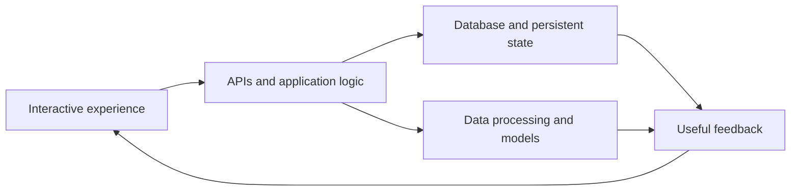

**Collaborative work management**

A TypeScript Kanban application with workspaces, boards, lists, rich card details and Socket.IO board updates.

`React` `Express` `PostgreSQL` `Prisma`

[Explore the application →](https://github.com/xavier812/RevKan)

</td>
<td width="50%" valign="top">

### 02 · RevMarket / FluidReach
**Customer outreach workspace**

A Next.js and Firebase marketing dashboard with contacts, campaigns, analytics and WhatsApp API integration. In development.

`Next.js` `TypeScript` `Firebase`

[Explore the application →](https://github.com/xavier812/RevMarket)

</td>
</tr>
<tr>
<td width="50%" valign="top">

### 03 · RainInsight
**Weather and rainfall exploration**

A Streamlit dashboard combining weather APIs, location maps and experimental rainfall-model inference.

`Python` `Keras` `Folium` `Plotly`

[Explore the experiment →](https://github.com/xavier812/RainInsight-Rain-Prediction-and-Forecasting-)

</td>
<td width="50%" valign="top">

### 04 · Stock Price Prediction
**Interactive model comparison**

Historical stock-data exploration with LSTM, BiLSTM and XGBoost, moving-average charts and test-period comparisons.

`Streamlit` `TensorFlow` `XGBoost`

[Explore the experiment →](https://github.com/xavier812/Stock-Price-Prediction)

</td>
</tr>
</table>

### More from the lab

| Project | What it explores |
| --- | --- |
| [Face Recognition Attendance](https://github.com/xavier812/Face-Recognition-Based-Attendance-Monitoring-System) | Tkinter enrollment interface, OpenCV LBPH recognition and local CSV attendance |
| [Online Payment Fraud Detection](https://github.com/xavier812/Online-Payment-Fraud-Detection) | Transaction exploration and a decision-tree classification notebook |
| [Campus Event Management](https://github.com/xavier812/campus-event-management) | PHP forms, event CRUD and MySQL-backed user flows |
| [Instagram Login UI Study](https://github.com/xavier812/Instagram-Login-Clone) | A static HTML/CSS login layout with JavaScript input interaction |

## / technology in the code

| Layer | Technologies used across these repositories |
| --- | --- |
| Interfaces | React, Next.js, TypeScript, Tailwind CSS, Streamlit, Tkinter |
| Services | Node.js, Express, Socket.IO, PHP |
| Persistence | PostgreSQL, Prisma, Firebase / Firestore, MySQL, CSV |
| Models and analysis | TensorFlow / Keras, scikit-learn, XGBoost, OpenCV, pandas, NumPy |
| Local tooling | Git, npm, Vite, Docker Compose, Jupyter |

## / how the pieces connect

Each project README describes the implementation, local setup and current limitations. Experimental model outputs are presented as experiments, with evaluation work still to do.

<b>/ explore by interest</b>

- **Full-stack applications:** start with RevKan and RevMarket.
- **Time-series experiments:** start with RainInsight and Stock Price Prediction.
- **Computer vision:** explore Face Recognition Attendance.
- **Foundations:** explore the PHP event manager and static frontend UI study.

## / connect

[Email](mailto:xavierroy812@gmail.com) · [GitHub repositories](https://github.com/xavier812?tab=repositories) · [Open a profile discussion issue](https://github.com/xavier812/xavier812/issues)

Build something useful. Understand the moving parts. Keep improving.

